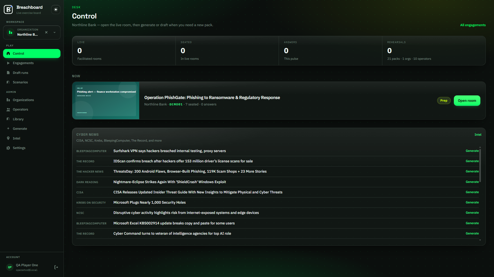

# Image guidelines

Rules for the screenshots in the [operator guide](./README.md). Files live in `docs/guide/images/` and are committed with the docs.

## Field and chrome

- Default field is **Pitch Obsidian** (`data-theme="dark"`). Recapture in **Toxic Phosphor Day** only when the section is about the sun/moon toggle.
- Keep the left rail in the frame. Crop it only for a full-screen overlay (Inject workshop, Present, Stage).
- Viewport **1440 × 900**. PNG. No JPEG on UI chrome.
- Hide the browser frame, the OS taskbar, and DevTools. A full-page shot is fine when one card (Crisis and IRC documents, for example) would otherwise be cut off.

## Naming

Files are `NN-kebab-slug.png`, numbered in reading order.

| File | Screen |
|------|--------|
| `01-login.png` | `/login` |
| `02-control.png` | Control desk |
| `03-engagements.png` | Engagements board |
| `04-msel-edit.png` | Scenario MSEL, draft |
| `05-msel-accepted.png` | Scenario MSEL, accepted |
| `06-intel.png` | Threat intel, RSS and advisories |
| `07-generate.png` | Generate SitMan |
| `08-sitman-discussion.png` | SitMan discussion modules |
| `09-inject-workshop.png` | Inject workshop |
| `10-session-console.png` | Live or prep session console |
| `11-org-storage.png` | Organization documents and retention |

## What to show

Use **Northline Bank** and join code **DEMO01** so the shots match the walkthrough. Show a filled news list, a seated roster, and real inject titles.

An empty “No active engagements” state belongs in the copy, not as the main image. Skip loading spinners, 404 pages, error toasts, and a rail that has not finished hydrating.

## What to leave out

- Passwords in the clear, TOTP secrets, SMTP passwords, LLM API keys
- Client IRP or CCMP body text (the filename on the org card is enough)
- Production emails or personal phone numbers
- A `?_rsc=` query in the address bar (crop it, or recapture after a clean navigation)

## Alt text

Every figure is ``. The alt names the screen and what is happening on it.

```markdown

```

## Recapture

Replace the PNG with the same filename when the rail, a primary button, or a card layout changes. Links in `README.md` stay valid that way.
