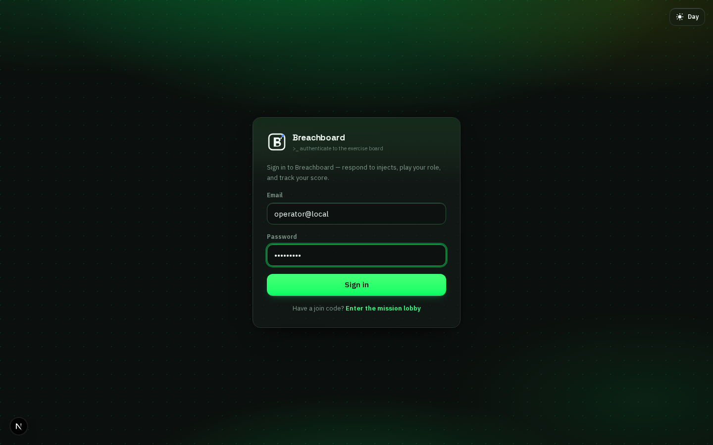
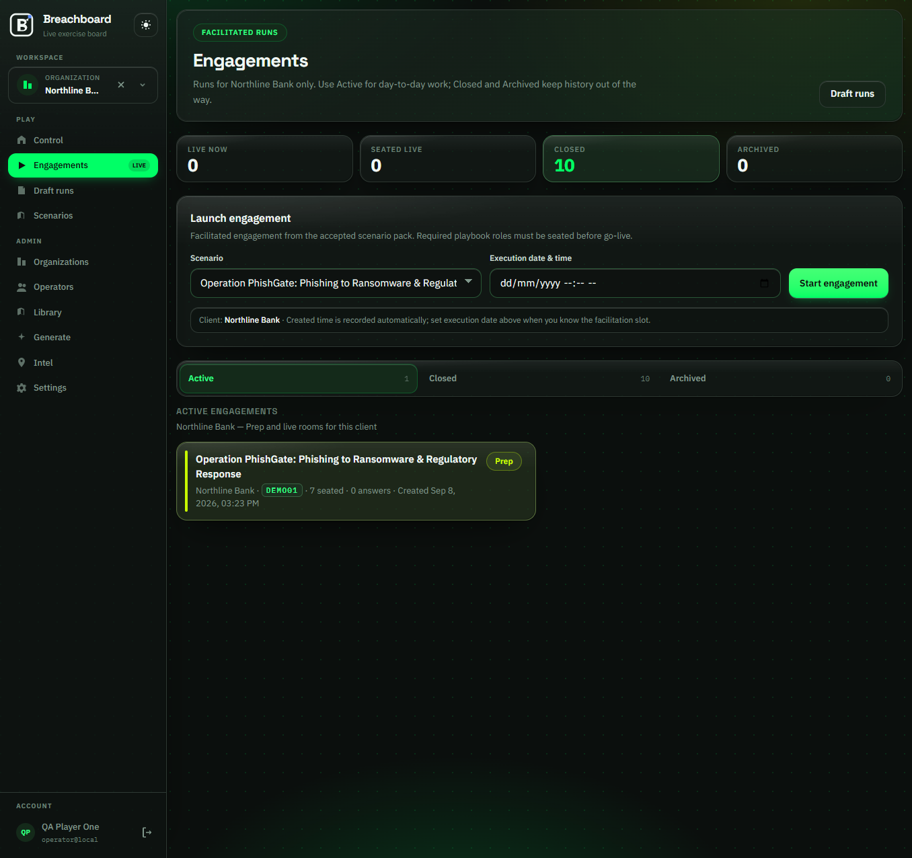
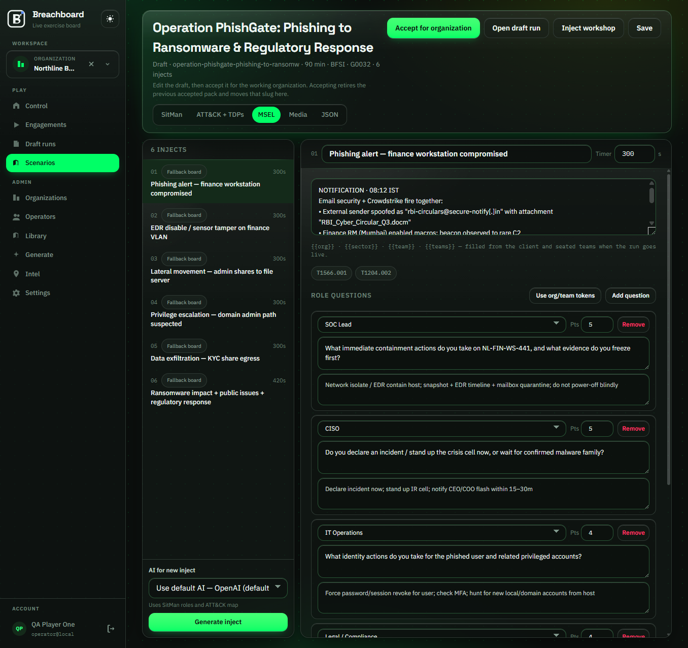
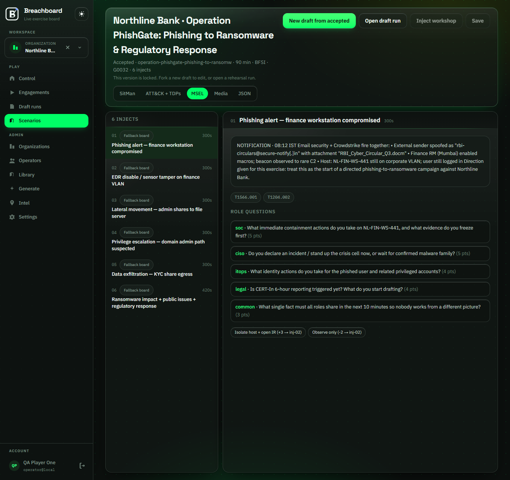
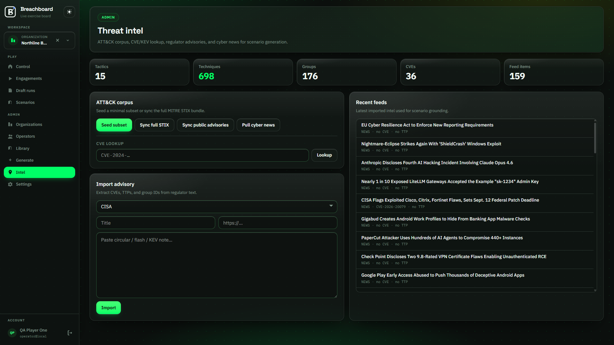
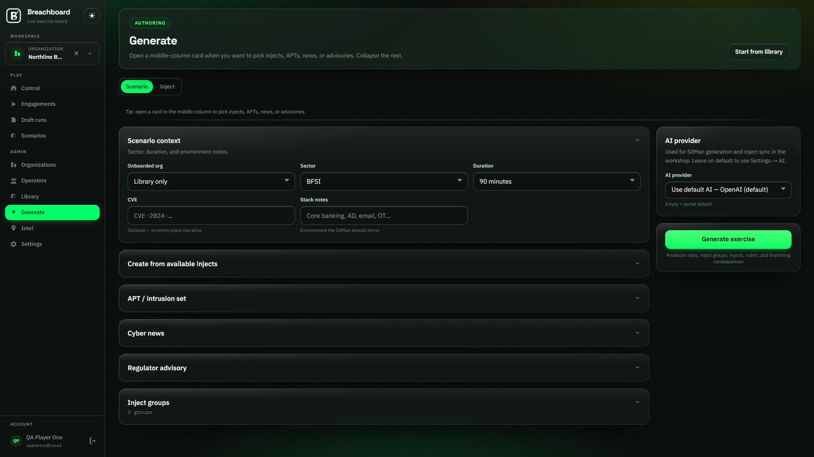
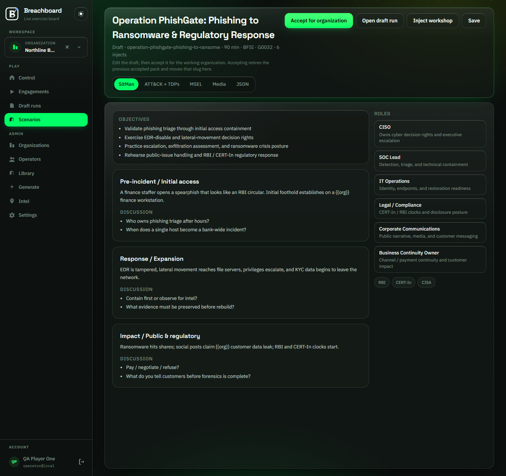
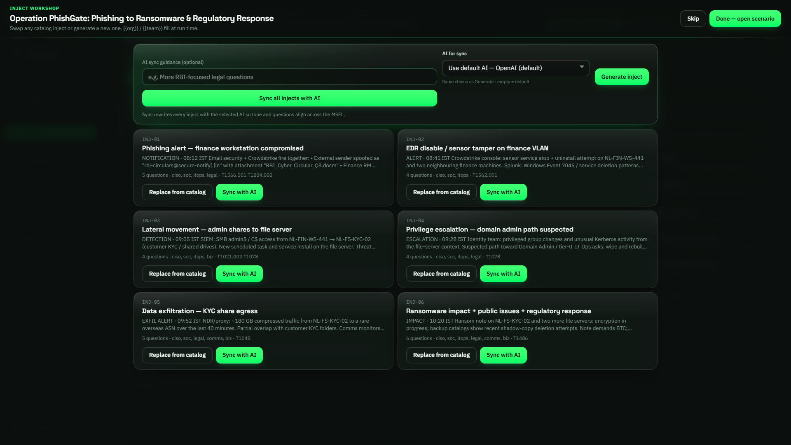
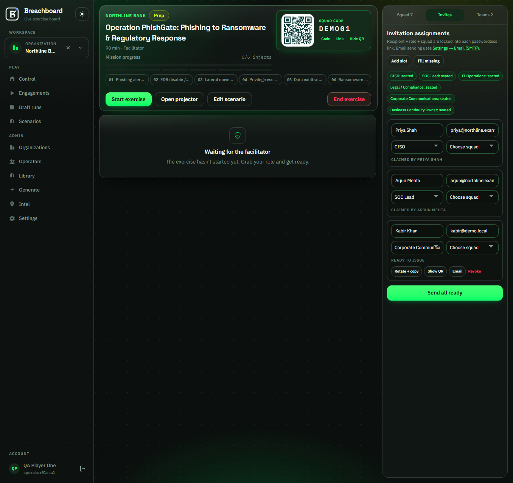
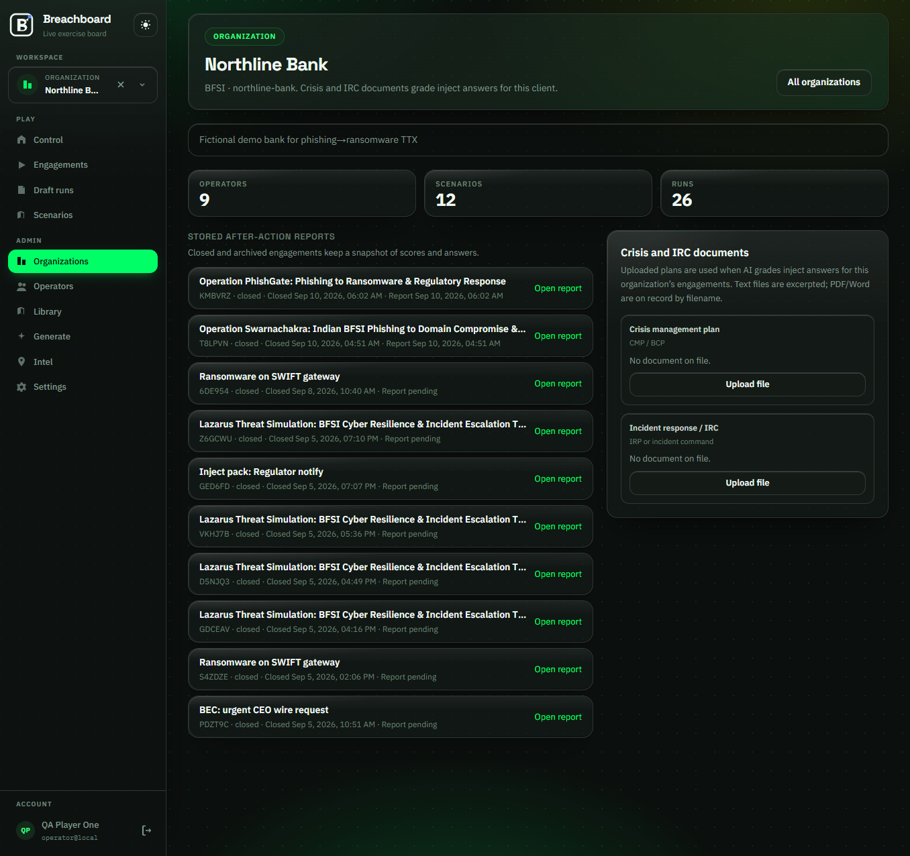

# Running a Breachboard tabletop

Start the stack with `./start.sh` from the [repo root](../../README.md). The app comes up at <http://localhost:3080>. Sign in with `OPERATOR_EMAIL` and `OPERATOR_PASSWORD` from `.env`. On a fresh local stack those are `operator@local` and `change-me`, and the first login creates the admin user.

Players never use that page. They open `/join`, type a name, and enter a squad code.

Screenshot rules live in [image guidelines](./IMAGE-GUIDELINES.md).

## Getting started

An operator builds the scenario and the client. A facilitator drives the room: injects, the clock, scores, Present, and Stage. A player joins with a squad code, answers the questions for their role, and picks up points. An observer is seated and can watch, but cannot answer.

The sun/moon control in the corner switches Pitch Obsidian and Toxic Phosphor Day. The choice is stored as `breachboard-theme`.

After sign-in you land on **Control**. Pick the client under **Workspace** (Northline Bank in the demo). The rail stays up on every page except login and join.

**Play** is Control, Engagements, Draft runs, and Scenarios. **Admin** is Organizations, Operators, Library, Generate, Intel, and Settings. **Account** is the profile, password, 2FA, and Sign out.

The **Now** card is the room to open. **Cyber news** is the same RSS the Intel hub stores. **Generate** on a headline opens `/generate` with that story already filled in.

If Control asks you to pick an organization, use Workspace. If you cannot go live, use **Seat myself as Facilitator**.

**Engagements** is the client board. **Draft runs** is rehearsal: role coverage is skipped, so you can start alone. The demo join code **DEMO01** is Operation PhishGate.

Open Engagements, pick an accepted pack, and start the engagement. Or open the prep room already on the board. Share the squad code, the QR, or send role invites.

**Start exercise** opens a short discuss window, about two minutes. Then **Open questions**. **Open projector** when you want the room display.

## Updating a tabletop and the news feeds

Scenarios sit under **Play → Scenarios**. A draft is editable. **Accept for organization** locks the pack, and only an accepted pack can launch a real engagement.

A pack has five tabs. **SitMan** is objectives, discussion modules, and roles. **ATT&CK + TDPs** is the mapped groups and techniques. **MSEL** is the inject timeline, timers, role questions, and points. **Media** is the Stage image cues. **JSON** is the raw document.

On a draft, edit the inject title, the notification body, ATT&CK IDs, and the questions for each role. **Pts** on a question is the ceiling. AI grading and a facilitator override both stop there.

An accepted pack is read-only. When the live pack needs a change, use **New draft from accepted**, or the Inject workshop on a draft. Do not edit the accepted MSEL in place.

Library packs (`.ttxpack`) install under **Admin → Library**. Import or export there, then accept the clone for the working org.

**Admin → Intel** is the feed desk. Control’s cyber news is a view of the same store.

The built-in RSS outlets are CISA, NCSC, Krebs on Security, BleepingComputer, The Record, The Hacker News, and Dark Reading.

- **Seed subset** loads a small ATT&CK set for air-gapped QA.
- **Sync full STIX** downloads MITRE ATT&CK.
- **Sync public advisories** pulls CISA KEV JSON and the CISA alerts RSS, unless `AUTO_ONBOARD_INTEL` is `false`.
- **Pull cyber news** fetches those RSS outlets into **Recent feeds**.
- **Import** takes a pasted CERT-In, RBI, or CISA circular and pulls out CVEs, TTPs, and group IDs.
- **CVE lookup** asks NVD/KEV for one `CVE-YYYY-…`.

Once Intel has items, sector regulator feeds from the last 24 months show up on **Generate**. CERT-In, RBI, and FBI items that are not in the public RSS list stay paste-import only. From Control, **Generate** on a headline is the short way from a story to a new SitMan.

## Injects and discussion

**Admin → Generate** has two tabs. **Scenario** builds a full pack: roles, inject groups, injects, rubric, and branching. **Inject** builds one catalog inject you can mix in later.

Fill **Scenario context**: org, sector, duration, an optional CVE, and stack notes. The middle column holds up to three APTs, three news items, and three regulator advisories. Default inject groups are Blue Cell, Crisis Comms, and Business Continuity.

The model comes from **Settings → AI** unless you override the dropdown. **Generate exercise** writes a **draft**.

Each module has **discussion questions**. That is the talk-track for the live discuss phase, about 120 seconds. Players can see the inject. They cannot answer until the facilitator clicks **Open questions**, or until the timer moves on.

Open the draft, then **SitMan**. Edit objectives, the module narrative, and the Discussion lists. The role cards on the right are the seats the MSEL questions are written for.

Discuss is a clock on the session, not its own page. Every seat sees the same remaining seconds.

The Inject workshop is how you change beats without regenerating the SitMan.

- **Replace from catalog** swaps in a library inject.
- **Sync with AI** rewrites one inject.
- **Generate inject** appends a beat.
- **Sync all injects with AI** does one tone pass across the MSEL.

`{{org}}` and `{{team}}` fill in when the room is running.

Accept the draft when the MSEL and the discussion questions are ready, then launch it from Engagements.

## Scoring and plan storage

Points are set on each MSEL question (**Pts**). During answering, a seated player submits the response for their role. AI grades it against the inject rubric and posts the points. Anything still marked for review stays at 0 until a facilitator overrides it.

Players with a playbook role see **Your score** (earned, max, and rank). Facilitators see **Team responses**: the AI score, a points adjustment up to the question max, and an override note. Those notes land on `/sessions/[id]/report`.

A prep room such as DEMO01 shows the inject map, the squad code, and the roster before **Start exercise**. Score cards show up after the first answers on the current inject.

**End exercise** writes the after-action report: leaderboard and override notes. Closed reports also list on the organization page.

Client IRP and CCMP files are what the grader reads. They are not shown on Stage. Open **Admin → Organizations**, then the client, then **Crisis and IRC documents**.

There are two slots: **Crisis management plan** (CCMP / BCP) and **Incident response / IRC** (IRP). **Retention after close** defaults to **14 days** (1–365). Save a different window before you upload.

Allowed types are PDF, DOC, DOCX, TXT, MD, and CSV. Extraction stops at 20 MB and 50 pages. The bytes live under `MEDIA_ROOT` (default `./data/media`, Docker volume `/data/media`). Next.js does not serve that tree.

Upload on the org, or on the session, while the room is still in prep. Closing an **engagement** soft-deletes the standing org plans for that client. Closing a **draft** does not. Soft-deleted files stay on disk until the retention sweep hard-deletes them.

The sweep runs in-app on `DOCUMENT_RETENTION_SWEEP_MS`, or from `npm run retention:sweep`, or from `POST /api/internal/retention/run` with `RETENTION_CRON_SECRET`. Abandoned active files cap at **365 days**.

Which window wins is upload, then session, then org, then 14 days. Files stay on the Docker volume `ttx_media` (`MEDIA_ROOT=/data/media`). A second app replica needs shared object storage before it is safe.

Do not put IRP or CCMP files under `public/`. Generated Stage media stays in `public/media/generated/` and is gitignored.

## Image guidelines

[IMAGE-GUIDELINES.md](./IMAGE-GUIDELINES.md) covers viewport, filenames, alt text, and what must not appear in a committed shot.
